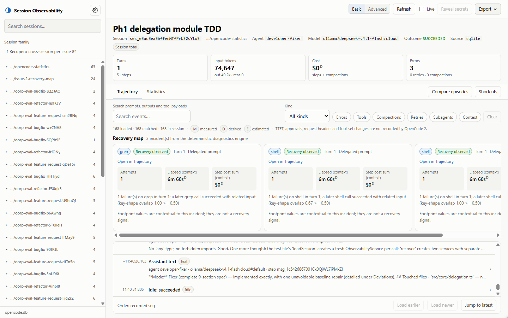
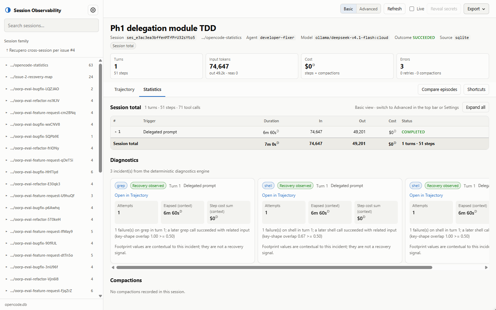

# OpenCode Session Observability

Every OpenCode 2 session leaves behind a rich event ledger — prompts, tool calls, retries, errors, compactions, tokens and cost — that is painful to reconstruct by hand. This tool opens that ledger locally and read-only: no telemetry, no writes to your data.

[](https://github.com/NicoGenti/opencode-statistics/actions/workflows/ci.yml)

A local-first, read-only observability layer for **OpenCode 2** sessions. It adds two views:

- **Trajectory** — a faithful, filterable ledger of every recorded session event: prompts, assistant steps, reasoning, tool calls/results, subagents, retries, errors, compactions, context notices, model/agent/location switches and session provenance markers.
- **Statistics** — a dense per-turn/per-step table with context size, tokens, cache reuse, cost, model/tool/residual time, output speed and status, plus distinct compaction transactions.

The implementation is original and targets OpenCode 2.2.x. It was built against the installed data format (`session_v2`, `session_message`) and the published OpenCode 2 plugin API (`@opencode/plugin` 2.2.6).

> The analysis is **read-only**. The SQLite source opens the database with `SQLITE_OPEN_READONLY` and sets `PRAGMA query_only = ON`. Nothing in the app writes sessions, messages or configuration.

---

## What you get

| Area | Delivered |
|---|---|
| Data adapter | OpenCode 2 SQLite (`session_v2`, `session_message`), OpenCode server API (`ctx.session.*`), in-memory fixture source |
| Normalization | Typed `NormalizedEvent` stream for every persisted message type and assistant content block |
| Projection | Turns, steps, tool calls, subagents, compactions, non-step events, unattached events |
| Metrics | Prompt/context tokens, cache hit rate, model/tool/residual/total time, output speed, cost, context deltas |
| UI | Local browser app: Trajectory + Statistics, Basic/Advanced modes, OpenCode themes, project-grouped session tree, settings, filters, full-text search, detail drawer, copy, export |
| Integration | OpenCode 2 server plugin with read-only RPC + TUI commands `/observability`, `/trajectory`, `/statistics` (alias `/stats`, web variant `/statistics:web`) |
| Export | Self-contained HTML, Markdown and JSON |
| Tests | 226 tests: parsing, projection, metrics, paging, scroll preservation, redaction, authentication, adapters, HTTP API, RPC, exports, settings/theme persistence, TUI routing seams, read-only guarantees |

Screenshots of both views in dark and light mode (1440×900):

<picture>
  <source media="(prefers-color-scheme: dark)" srcset="docs/screenshots/trajectory-dark.png">
  
</picture>

<picture>
  <source media="(prefers-color-scheme: dark)" srcset="docs/screenshots/statistics-dark.png">
  
</picture>

---

## Requirements

- **Node.js 24.x** (tested with 24.18). `node:sqlite` is built in. Node 22.18+ may require `--experimental-sqlite` depending on the exact release.
- **OpenCode 2.2.x** session data. The tested database was produced by `@opencode/cli` **2.2.5**; the plugin types were checked against `@opencode/plugin` **2.2.6**.
- A local browser and/or the OpenCode 2 TUI.

The app does **not** support the OpenCode 1 schema (`session`/`message` tables). It detects that schema and reports it clearly instead of reading incompatible data.

---

## Quick start

```bash
npm install
npm start
```

`npm start` discovers an OpenCode 2 database automatically (see below), starts a local server on `http://127.0.0.1:4517`, and prints the URL and database path.

By default the server generates an access token, prints the tokenized URL, and writes a per-port token file so the TUI can open the authenticated UI without copying the token.

Open the printed URL. The token is carried in the URL fragment, removed from the address bar after the UI loads, and kept in `sessionStorage` for that tab.

Disable authentication on loopback:

```bash
npm start -- --no-auth
```

Use a stable explicit token:

```bash
npm start -- --token=<value>
```

Explicit tokens are not written to disk. Configure the TUI with the `token` plugin option or `OPENCODE_OBSERVABILITY_TOKEN`.

Explicit database and port:

```bash
npm start -- --db "C:/Users/me/.opencode2/data/opencode/opencode.db" --port 4517 --open
```

Other flags:

```text
--db <path>     OpenCode 2 SQLite database
--host <host>   Bind address (default 127.0.0.1)
--port <port>   Port (default 4517; 0 picks a free port)
--reveal        Allow the explicit reveal-secrets mode
--no-reveal     Keep reveal disabled (the default)
--token         Generate a per-run access token (default) and print it
--token=<value> Use an explicit access token (at least 16 characters)
--no-auth       Disable the access token (loopback only)
--allow-remote  Allow a non-loopback --host; authentication stays required
--open          Open the browser after starting
--help, -v      Help / version
```

`--token` and `--no-auth` are mutually exclusive. A non-loopback bind is refused when authentication is disabled.

Run the checks:

```bash
npm run check       # typecheck + 226 tests (node:test)
npm run audit:prod  # production dependency audit (0 advisories)
```

---

## Database discovery

The CLI looks for `opencode.db` in this priority order and picks the first **OpenCode 2** database:

1. `--db <path>` (authoritative; must be an OpenCode 2 database)
2. `OPENCODE_OBSERVABILITY_DB`
3. `OPENCODE_DB`
4. `$XDG_DATA_HOME/opencode/opencode.db`
5. `~/.opencode2/data/opencode/opencode.db` (isolated OpenCode 2 profile, e.g. `opencode2.cmd`)
6. `~/.local/share/opencode/opencode.db`
7. Windows: `%LOCALAPPDATA%\opencode\opencode.db`, `%APPDATA%\opencode\opencode.db`
8. macOS: `~/Library/Application Support/opencode/opencode.db`
9. Linux: `~/.config/opencode/opencode.db`

If only an OpenCode 1 database is found, the app exits with an explicit error. Use `--db` to point at the OpenCode 2 store.

The server never reads `auth.json`, `service.json` or provider credentials. It opens only the session database.

---

## OpenCode 2 plugin integration

The package is both a standalone app and an OpenCode 2 plugin with a **server part** and a **TUI part**:

```text
exports: "."            -> server plugin (RPC)
         "./tui"        -> TUI plugin (slash commands)
         "./rpc"        -> typed RPC contract
```

Why this shape? OpenCode 2.2.x plugins can add tools, hooks, RPC methods, commands, agents, TUI routes/slots and experimental GUI panels. They do **not** expose arbitrary HTTP routes for a third-party web page. The supported integration path is therefore:

1. the **server part** registers a read-only RPC namespace over the OpenCode client;
2. the **TUI part** registers `/observability`, `/trajectory` and `/statistics`, which open the local web UI for the session currently shown in the TUI;
3. the **web UI** runs as a separate local read-only server, so it works from the TUI, a browser, or any local client.

### Configure

For a local checkout, copy `opencode.jsonc.example` into your OpenCode config and adjust the path:

```jsonc
{
  "$schema": "https://opencode.ai/config.json",
  "plugins": [
    {
      "package": "<path-to-repo>",
      "options": {
        "url": "http://127.0.0.1:4517",
        "allowReveal": false
        // "token": "optional override; the TUI reads the run token file by default"
      }
    }
  ]
}
```

For a published package:

```jsonc
{
  "plugins": ["opencode-session-observability"]
}
```

The TUI loads the TUI parts of plugins its server loads. The TUI commands only open the browser; they never inject a prompt into the session.

The TUI reads the per-port token file written by `npm start`. The optional `token` plugin option, or the `OPENCODE_OBSERVABILITY_TOKEN` environment variable, overrides it. An explicit `--token=<value>` is never written to disk, so it must be provided through one of those two settings. The TUI never prints the token in a toast.

### Config examples: `opencode.jsonc.example` vs `cli.json.example`

Two example configs ship with the repo:

- `opencode.jsonc.example` — the full plugin entry with the `url`, `allowReveal`, `theme` and `token` options, as shipped in `opencode.jsonc.example`. Use it for a local checkout or to change the port or allow reveal.
- `cli.json.example` — the minimal registration-only list for the bare CLI config, when the defaults are enough (loopback `http://127.0.0.1:4517`, reveal off, theme forwarded by the TUI, token read from the per-port file):

```json
{
  "$schema": "https://opencode.ai/config.json",
  "plugins": ["opencode-session-observability"]
}
```

### Use

Start the local UI once:

```bash
npm start
```

Then in the OpenCode 2 TUI:

```text
/observability   open the Trajectory view for the current session
/trajectory      same, explicit Trajectory
/statistics      open the Statistics view for the current session
/stats           alias of /statistics
/stats:web       open the Statistics web UI (also /statistics --web)
```

If the UI is not running, the command shows a toast with the command to start it. If the UI requires a token and the plugin has none, it shows how to provide one instead of opening an unauthenticated page. The URL is configurable with the plugin option `url`; it must point at a loopback address (`127.0.0.1`, `localhost` or `::1`). Native in-TUI rendering becomes live only when sibling issues #6/#8 register the `statistics` view through `registerNativeView`; until then `/statistics` falls back to the browser with an info toast.

### RPC namespace

`session-observability` exposes these methods (read-only):

| Method | Purpose |
|---|---|
| `health` | source, version, reveal policy, read-only flag |
| `sessions` | list/search sessions |
| `session` | session metadata + parent/children family |
| `analysis` | turns, steps, compactions, totals, event index |
| `eventPage` | filtered/keyset-paged event rows |
| `event` | one full event payload |
| `export` | JSON / Markdown / HTML report |

`reveal` defaults to `false`. The plugin option `allowReveal` also defaults to `false`; set it to `true` to permit reveal for RPC callers.

> **Desktop GUI note.** The experimental `./gui-experimental` panel API is not shipped. Desktop users use the same browser UI. The server RPC is available to future GUI or external clients.

---

## UI guide

### Trajectory

- Events are ordered by the **recorded per-session sequence**, not by a reconstructed conversation. Timestamp regressions are flagged, never re-sorted.
- Rows are grouped by turn and step. Unattached events appear in recorded order under an **Unattached** header.
- Badges: error, retry, compaction, context, subagent, uncertain. A `~` before a timestamp means the block timestamp is approximate; the recorded order is still exact.
- Filters: full-text search, kind, agent, model, provider, tool, status, time range, prompt-token range, and shortcut chips for errors/tools/compactions/retries/subagents/context.
- Click an event to open the detail drawer: full payload JSON, text/reasoning, tool input/output/error/metadata/diff, subagent links, copy JSON/text/metrics/turn chain.
- Parent/child sessions are linked in the sidebar family section and in subagent tool results.

### Statistics

- One row per turn; click a turn to expand its steps. Click a step to expand its inline detail (Markdown response, reasoning, tool calls, subagent links).
- `Context basis` switches the turn context column between **Latest** (final prompt of the turn) and **Cumulative** (sum of step prompts). The session total row always shows both final and cumulative context independently.
- `Show event rows` adds non-step rows (system/context notices, switches, retries, errors, compactions, synthetic/skill/shell events) to expanded turns and lists unattached events. These rows are never summed into turn/step totals.
- Compactions are shown as distinct transactions with before/after context, removed tokens, summary size, compaction usage and cost. Duration is marked unavailable because OpenCode records only a compaction timestamp.
- Click “Open in Trajectory” on a compaction or “Open step in Trajectory” on a step to jump to the exact event.
- `Recorded by OpenCode` compares computed totals with the session-row totals.

### Keyboard shortcuts

| Key | Action |
|---|---|
| `/` | Focus event search |
| `1` / `2` | Trajectory / Statistics |
| `e` `t` `c` `r` `s` | Toggle errors / tools / compactions / retries / subagents |
| `j` / `k` | Next / previous event |
| `Enter` | Open selected event |
| `g` / `G` | Top / bottom |
| `?` | Shortcut dialog |
| `Esc` | Close drawer/dialog |

### Deep links

```text
http://127.0.0.1:4517/#/s/<sessionID>/trajectory
http://127.0.0.1:4517/#/s/<sessionID>/statistics
http://127.0.0.1:4517/#/s/<sessionID>/trajectory?event=<eventID>
```

### Export

The Export menu downloads:

- **JSON** — normalized session, analysis, event index and (by default) full normalized events;
- **Markdown** — summary, turns, steps, compactions, trajectory and limitations;
- **HTML** — one self-contained report with no external assets.

Exports are **redacted by default**. Turn on `Reveal secrets` (with confirmation) to export raw payloads. Reveal is disabled on the server unless it was started with `--reveal`.

---

## Metrics at a glance

| Metric | Definition | Basis |
|---|---|---|
| Prompt tokens | `input + cache.read + cache.write` | derived |
| Cache hit rate | `cache.read / prompt`, token-weighted | derived |
| Model time | `time.created → time.streamed` | derived |
| Step total | `time.created → time.completed` | derived |
| Tool time | sum of `tool.time.ran → tool.time.completed` | derived |
| Residual | step total − model − tool; negative means overlap | derived |
| Turn total | last completed step end − first step start | derived |
| Output speed | output tokens / model-generation seconds | derived |
| Context (turn) | latest final prompt or sum of step prompts | derived |
| Context delta | current final prompt − previous turn final prompt | derived |
| Compaction before/after | compaction request prompt / next step prompt | derived |
| Cost | sum of recorded step + compaction costs | derived |
| TTFT | not persisted | unavailable |
| Approvals / request headers / tool-set changes | not persisted | unavailable |

See [docs/METRICS.md](docs/METRICS.md) for formulas, caveats and worked examples.

---

## Read-only and privacy

- **Read-only connection**: `DatabaseSync(path, { readOnly: true })`, `PRAGMA query_only = ON`, `enableForeignKeyConstraints: false` (no writes).
- **No mutation APIs**: the adapter interface has only `listSessions`, `getSession`, `listMessages`, `messageBounds`, `getFamily`.
- **No session prompts**: the plugin and TUI commands never call `session.prompt`, `compact`, `interrupt` or any action method.
- **Access token (default on loopback)**: the server generates a 256-bit per-run token. Every `/api` route except `/api/health` then requires `Authorization: Bearer <token>` or `X-Observability-Token`. The token is printed in the URL fragment, stripped from the address bar, and kept in `sessionStorage`; it is never written to logs or error bodies. A per-port token file with user-only permissions lets the TUI reuse it (`%LOCALAPPDATA%\opencode-observability` on Windows, `$XDG_RUNTIME_DIR` or `~/.config/opencode-observability` elsewhere). `--no-auth` disables authentication on loopback only. `--token=<value>` uses an explicit token that is not persisted.
- **Redaction**: credential-shaped keys and strings are replaced with `[REDACTED]` by default. Token *counts* are metrics and are preserved.
- **Reveal**: disabled by default; enable with `--reveal` (server) or `allowReveal: true` (plugin). The browser confirmation is a UX safeguard, not an access control: any client that can reach the API, is allowed to reveal and has a valid token (when enabled) receives raw data. The UI shows a persistent warning while active.
- **Network**: bind `127.0.0.1` by default. Non-loopback binds require `--allow-remote` and authentication; `--no-auth` is refused off loopback. Requests are rejected unless the `Host` (and any `Origin`) belongs to the listener, which blocks DNS rebinding; CORS is not relied on.
- **Exports**: redacted by default; HTML/Markdown/JSON include a warning when redacted. When a token is enabled, download requests carry the same header.

Test coverage includes a SHA-256 before/after check proving analysis leaves the database file unchanged, and a read-only write-rejection test.

---

## Limitations

The honest list (details in [docs/CHECKLIST.md](docs/CHECKLIST.md)):

- **TTFT** is not persisted in OpenCode 2.2.x. It is always `—`.
- **Permission/approval decisions** are not stored in historical session data. There are no false “awaiting approval” rows.
- **Request headers** are available only to live `http.request` hooks; they are not in session storage.
- **Tool-set changes** are not persisted.
- **Exact compaction duration** is not persisted; only a completion timestamp is available.
- **Session-row totals** can include auxiliary model calls (title, generation, compaction) and therefore can differ slightly from the sum of visible steps.
- **Parallel tool calls** are summed; the sum can exceed wall-clock. The UI notes this.
- **Desktop GUI panel** is not shipped; the browser UI is primary.

---

## Project layout

```text
src/
  core/
    types.ts            normalized model and DTOs
    normalize.ts        message -> ordered NormalizedEvent[]
    project.ts          turns/steps/compactions/totals/capabilities
    metrics.ts          token/cache/duration/speed formulas
    service.ts          dataset loading, sanitization, filters, pagination, export
    export.ts           JSON / Markdown / HTML
    redact.ts/util.ts   credential redaction
    paging.ts           page merge, scroll anchor, virtual range
    adapters/
      sqlite.ts         OpenCode 2 SQLite, read-only
      api.ts            OpenCode server API source
      memory.ts         fixtures/tests
      paths.ts          database discovery
  server/
    index.ts            CLI
    http.ts             local HTTP API + static UI
    auth.ts             access-token generation and constant-time comparison
    token-file.ts       per-port token file read by the TUI
  ui/
    index.html
    styles.css
    app.js              views, state, filters, drawer, shortcuts
    auth.js             fragment token, sessionStorage and headers
    virtual.js          variable-height virtual list
    markdown.js         safe Markdown subset
    format.js            formatting + badges
    paging.js           UI-side page merge (mirrors core)
  plugin/
    index.ts            OpenCode 2 server part (RPC)
    define.ts           identity shims for the SDK's define helpers
    rpc.ts              typed RPC contract
    rpc-define.ts       local Rpc.define equivalent
    service.ts          RPC handlers
    tui.ts              TUI commands
test/
  fixtures/build.ts     synthetic OpenCode 2 fixtures
  *.test.ts             226 tests
docs/
  DATA-SOURCES.md
  ARCHITECTURE.md
  METRICS.md
  UI.md
  CHECKLIST.md
```

---

## Testing

```bash
npm run check       # typecheck + 226 tests
npm run audit:prod  # production dependency audit
```

The suite is pinned at **226 tests** for this revision (v0.1.0) and grows with each new suite.

The fixtures cover: a simple session, multiple tool calls (including parallel and error), subagents, retry + error, compaction, a long paging session, an incomplete/interrupted run, out-of-order timestamps, secrets, and an empty session. The HTTP tests start the real server on an ephemeral port against a synthetic SQLite database.

The OpenCode 2 SDK is a devDependency used only for types: the runtime plugin uses local identity shims for `Plugin.define` and `Rpc.define`, so the SDK's packaging toolchain is never loaded by this app. `npm run audit:prod` reports no advisories. The `overrides` in `package.json` pin `glob@14.0.4` and `minimatch@11.0.5` to clear the SDK's transitive packaging advisories, so a full `npm audit` also reports no vulnerabilities. Remove those overrides when OpenCode pins patched releases upstream.

A real-database smoke check:

```bash
npm start -- --db "%USERPROFILE%/.opencode2/data/opencode/opencode.db" --port 4517
```

or on a POSIX shell:

```bash
npm start -- --db "$HOME/.opencode2/data/opencode/opencode.db" --port 4517
```

---

## License

MIT. See [LICENSE](LICENSE).
