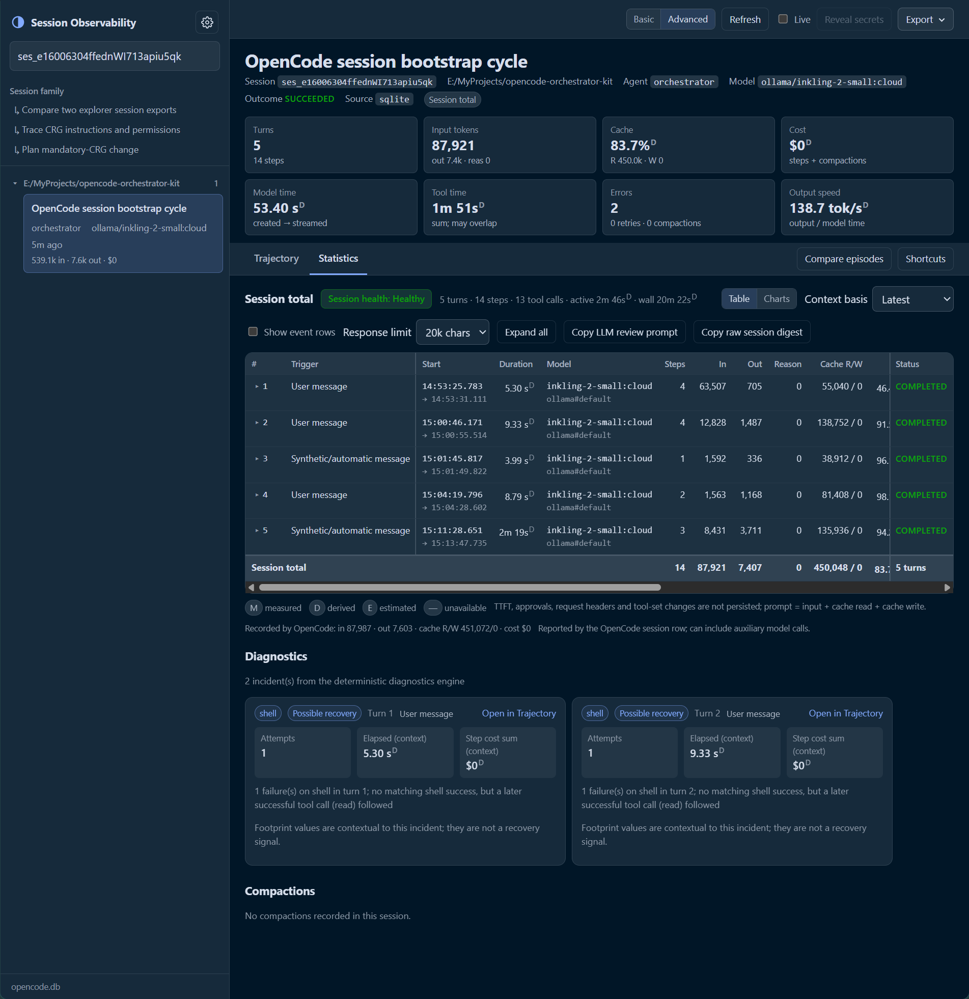
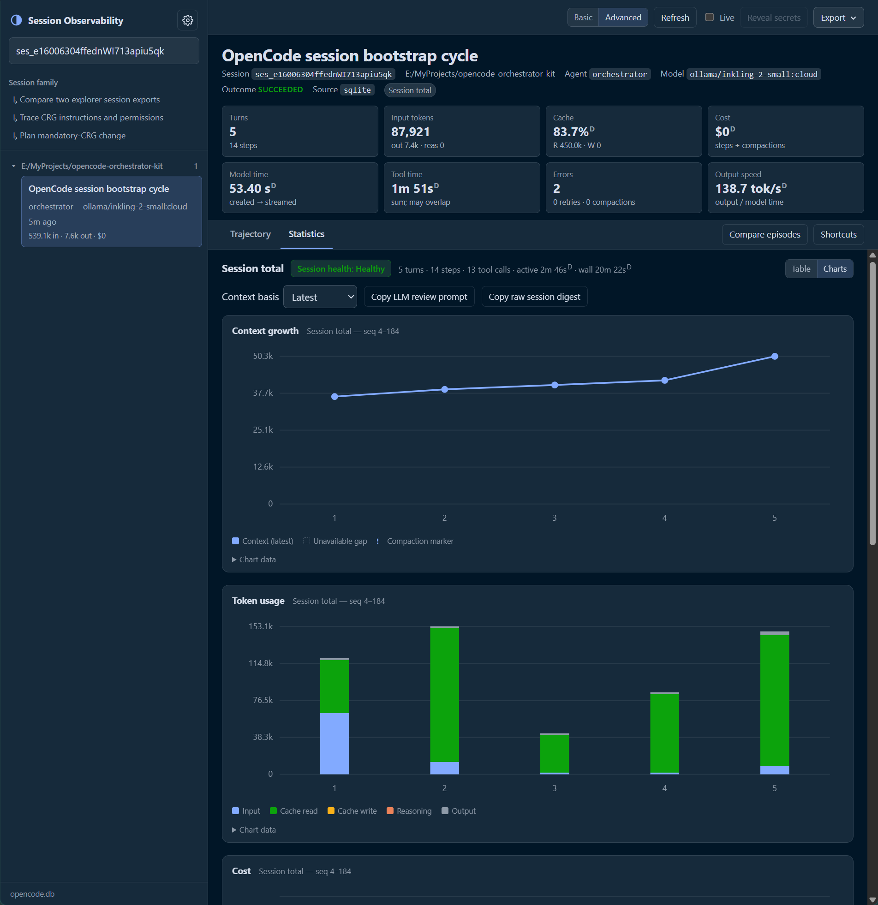

# UI guide

The UI is a local browser application served by the same read-only process that reads the OpenCode 2 database.

## Layout

- **Sidebar** — searchable session list grouped by project directory, with child sessions nested under their parents; the current session's family (parent/children) appears above the list.
- **Header** — session metadata and stat tiles (turns, input tokens, cache, cost, model/tool time, errors, output speed). Basic mode shows the four headline tiles.
- **Tabs** — Trajectory and Statistics.
- **Topbar** — Basic/Advanced view toggle, refresh, optional 10s live refresh, reveal secrets, export.
- **Detail drawer** — full event or step information, copy actions and links.
- **Settings** — the gear in the sidebar opens theme, view mode, grouping and statistics defaults.

## View modes

The topbar switches between two persisted modes:

| Mode | Header | Trajectory filters | Statistics |
|---|---|---|---|
| **Basic** | Turns, input tokens, cost, errors | Search, kind and the error/tool/compaction/retry/subagent/context chips | Turns with trigger, duration, in/out tokens, cost, status; expandable steps |
| **Advanced** | All eight tiles | Every filter and range control | Full 19-column turn/step table |

The mode is stored per browser and can also be changed from Settings.

## Themes

Settings lists the OpenCode 2 built-in theme names — `aura`, `ayu`, `carbonfox`, `catppuccin` (plus Frappé and Macchiato), `cobalt2`, `cursor`, `dracula`, `everforest`, `flexoki`, `github`, `gruvbox`, `kanagawa`, `lucent-orng`, `material`, `matrix`, `mercury`, `monokai`, `nightowl`, `nord`, `one-dark`, `opencode`, `orng`, `osaka-jade`, `palenight`, `rosepine`, `solarized`, `synthwave84`, `tokyonight`, `vercel`, `vesper` and `zenburn` — plus `System / Auto`, `Light`, `Dark` and `OpenCode (current)`.

`OpenCode (current)` mirrors the theme running in the TUI exactly: the TUI sends the resolved OpenCode colors in a `?palette=` fragment parameter, and the browser validates and applies them. A `?theme=<name>` parameter is kept as a fallback for older clients.

When the page is opened directly (without a TUI deep link), `/api/health` reports the `theme` selected in OpenCode 2's CLI config (`~/.opencode2/config/opencode/cli.json`, with XDG/platform fallbacks), and the UI applies that theme on load. An explicit pick in Settings wins from then on; unknown names fall back to `auto` or the closest light/dark match.

## Session grouping

Sessions are grouped by `directory` (falling back to `projectID`, then “(no project)”). Project groups start collapsed and show the session count; expanding one reveals its sessions. Child sessions are nested under their parent, and those families also start collapsed. Expanded projects and parents persist per browser; grouping and nesting can be turned off in Settings. Searching auto-expands matching branches.

## Trajectory

Rows are chronological by recorded session sequence. Turn headers and step headers are inserted as the sequence changes. Events that could not be attributed remain in place with an **Unattached** header; they are never attached to an arbitrary turn.

### Filters

| Control | Behavior |
|---|---|
| Search | Full-text over prompts, reasoning, assistant text, tool names, tool payloads and serialized event payloads. The field label names the scope; the placeholder is only a hint. Redacted text is searched by default. |
| Kind | `assistant`, `reasoning`, `text`, `tool`, `user`, `synthetic`, `system`, `skill`, `shell`, `compaction`, switches, `idle`, `retry`, `error`, `session`, `unknown` |
| Agent | Event agent, including delegated subagent agents |
| Model | `provider/id` |
| Provider | Provider ID |
| Tool | Tool name |
| Status | Tool status or event status (`completed`, `error`, `running`, …) |
| From / To | Event timestamp range (`datetime-local`) |
| Min / Max prompt tokens | Prompt-token range; events without token usage are excluded when a bound is set |
| Chips | Errors, Tools, Compactions, Retries, Subagents, Context |
| Clear | Clears all filters |

Filters are applied on the server, so search spans the whole session, not only the loaded page. Changing a filter resets to the newest matching page.

### Recovery map

A **Recovery map** strip sits between the filter bar/legend and the ledger. It reads `analysis.diagnostics.incidents` from the deterministic engine verbatim; the UI never computes an incident. With no incidents it shows “No diagnostic incidents recorded in this session.”

Each card shows the tool, a recovery badge, `Turn N`, the projected trigger, **Open in Trajectory**, three stat cells (Attempts, Elapsed (context), Step cost sum (context)), the rule's `why`, and the note that footprint values are contextual to the incident and are not a recovery signal. A value the engine could not record renders `—` with an unavailable title. Cards carry no tool input/output or error text; the `why` is the engine's own rule explanation.

| Recovery state | Badge label | Badge treatment |
|---|---|---|
| `recovered` | Recovery observed | good |
| `possible-recovery` | Possible recovery | accent |
| `no-recovery-evidence` | No recovery evidence | dashed neutral |
| `insufficient-data` | Insufficient data | dashed neutral |

**Open in Trajectory** (or a deep link) loads the event page centered on the incident's first failing event, highlights every event in its `failureEventIDs` set with the accent rule and `accent-weak` background, and opens the drawer. The highlight is rebuilt only from the stored incident whose `firstFailureEventID` matches the opened event; opening any unrelated detail event or switching sessions clears it. Closing the drawer leaves it in place.

### Ledger interactions

- Click a row to open the detail drawer.
- `j`/`k` moves the selection; `Enter` opens it.
- `Load earlier` prepends older rows and preserves the scroll anchor.
- `Load newer` appends rows after the newest loaded event.
- `Jump to latest` returns to the newest matching page.
- The gutter shows `HH:mm:ss.SSS` (UTC). A leading `~` means the block timestamp is approximate; recorded order is exact.
- The footer shows loaded/matched/session counts and the ordering note.

### Detail drawer

- Event metadata: IDs, seq/order, turn/step, agent, model/provider, status, timestamps, tokens, cost, uncertainty.
  Fields without a recorded value collapse under **Not recorded (N)**; IDs, timestamp, turn and order always stay visible.
- Text/reasoning.
- Tool call: status, duration, input JSON, output, error, metadata, diff patches, subagent links.
- Compaction transaction: before/after/removed/summary size/output tokens/cost/duration.
- Full raw payload JSON.
- Actions: Copy JSON, Copy text, Copy metrics, Copy turn chain, Show in Trajectory, open subagent session.
- `Esc` closes the drawer.

## Statistics

One row per turn. The first click expands steps; clicking a step expands its detail row. Expanded step rows use the same column meanings as turns; nested step counts and per-step context delta are unavailable and marked `—`.

Advanced-only (web app, Advanced view): the **Table / Charts** segmented control and all four charts, the **Session health** badge and rules breakdown, the **Task and file attribution** section, the **Copy LLM review prompt** / **Copy raw session digest** buttons, and the header **Benchmark** link (the `#/benchmark` route itself stays reachable by URL). Basic mode renders the turn table, headline filters and diagnostics but none of those surfaces; `renderStatisticsBasic()` carries no health markup. Charts and health live in the browser Statistics view only; the native TUI panel stays at the dense turn table.

<p>
  
  
</p>

### Turn columns

`#`, trigger, start → end, duration, model, provider (sublabel), steps, input/output/reasoning tokens, cache read/write, hit rate, context (latest or cumulative), Δ context, model time, tool time, residual, output speed, cost, status.

The first turn has no context delta. A negative residual is explained in the tooltip (parallel tool overlap).

### Step detail

- Trigger, start/end, model/provider, TTFT (always unavailable), finish, tools, subagents, uncertainty.
- Response or reasoning rendered as Markdown; long text is truncated with a note. The `Response limit` selector (4k/12k/20k/50k/80k characters) is persisted per browser. The analysis endpoint caps each step at 80k characters; the event detail endpoint still has the full recorded text.
- Tool call mini-cards with status/duration, input/output previews, subagent links.
- “Open step in Trajectory” jumps to the assistant step event. A `↗` button on each step row does the same without expanding the row.

### Context basis

- **Latest** — the last step's prompt size for each turn.
- **Cumulative** — the sum of all step prompt sizes in the turn.

The session total row always shows both final context and cumulative prompt, so the selector cannot change totals.

### Show event rows

Adds non-step rows for expanded turns and an **Unattached events** section. These rows are visually muted and explicitly marked “not included in turn/step totals”. They include system/context notices, agent/model/location switches, retries, errors, compactions, synthetic/skill/shell events.

### Charts

Advanced statistics also offers a **Table / Charts** sub-tab; Basic has no chart control, and the sub-tab is renderer state rather than a route. Charts draws four sections over the same `state.analysis` the table renders, with no extra fetch and no re-paging, so every section caption repeats the analysis scope (**Session total** or **Window total** plus the `coverage` sequence range). Filters refine the Trajectory ledger only; Statistics and Charts always show the loaded session analysis, and the caption says which.

- **Context growth** — one point per turn, following the **Context basis** selector (Latest or Cumulative). A missing context metric leaves a gap in the line, never a zero dip, and is drawn as a dashed unavailable tick; the section counts the gaps. Each compaction is a dashed vertical marker labelled `Compaction N`, placed on its recorded turn, or on the last turn that started before it when no turn was recorded; a compaction whose recorded turn is not in the loaded analysis cannot be placed and is counted in the section instead of being drawn onto a turn.
- **Token usage** — one stacked bar per turn with five segments: input, cache read, cache write, reasoning, output. A turn with `tokensComplete: false` is drawn with a dashed outline and says "partial: recorded subset only"; the recorded values are never padded. A turn whose steps recorded no usage at all is a dashed "Not recorded" slot, never a zero bar marked measured.
- **Cost** — one bar per turn, grouped and coloured by the model derived from that turn's steps (provider only where a step recorded one), with the axis labelled in USD. The highest available cost carries the text mark **Highest cost**, and tied turns are all marked, so colour never carries the ranking alone; an all-zero session marks nothing.
- **Step duration** — one stacked bar per step (`<turn>.<step>`) with model, tool and residual time. A segment that was not recorded is omitted rather than zero-filled; a step with none of the three draws a dashed "Not recorded" slot.

The chart is one `role="img"` graphic with a single chart-level label, so its datums are mouse targets: each carries a `<title>` and a label with its value and provenance mark (`M`, `D`, `E`, `—`), and clicking one opens the matching turn, step or compaction event in Trajectory through the existing event-jump path. A datum without a recorded anchor is not clickable and its label says "no event to open". The keyboard path is each section's **Chart data** `<details>` list: its buttons carry the same values and drill targets, so a screen reader user never depends on the graphic. The basis legend, **Diagnostics** and **Compactions** sections stay below the charts pane.

### Session health

Advanced Statistics only: a **Session health** badge sits in the statistics toolbar (`.stats-toolbar`), immediately after the `.stats-title` heading, in both the Table and Charts sub-tabs. It is a real `<button>` (`[data-health-toggle]`) carrying the state as text — `Session health: Healthy`, `Session health: Watch`, or `Session health: Degraded` — so colour is never the only signal; missing or insufficient data renders as `Watch` with an `insufficient data` sub-label and the dashed uncertain treatment. Clicking toggles a **rules breakdown** listing every rule with its level (`Watch`/`Strong`), status (triggered / not triggered / not evaluable), deterministic observed-values note, and capped drill links as `link-button`s carrying `data-event-id`, routed through the existing `bindStatistics()` loop and `jumpToEvent()` (no new wiring). Each rule's link count follows the event/turn caps (`MAX_EVENT_LINKS = 10`, `MAX_TURN_LINKS = 6`); turn links resolve to the turn's trigger event and are only rendered when an anchor exists.

Insufficient sessions show their sufficiency reasons at the top of the breakdown (`no turns were recorded`, windowed coverage, or neither token usage nor cost recorded). The badge `title`/`aria-label` and the breakdown header carry the standing copy "Derived signal from recorded observability data — not a quality judgment." and the footer repeats it. No numeric score is computed, stored or displayed, and the word "score" never appears. The Basic renderer and `renderStatisticsBasic()` contain no health markup.

Rules, thresholds, the sufficiency gate and the state mapping are documented in full in [HEALTH.md](HEALTH.md); the UI mirrors the same rule ids and thresholds.

### Task and file attribution

Advanced Statistics only, below the table/charts block and above the basis legend, and only when `analysis.attribution` is present: a session with no file, command or subtask signal renders no section at all. The header carries the provenance rail "Paths measured · cost shares derived · commits unavailable".

One card per attributed turn shows its recorded index, its trigger label (`User message`, `Delegated prompt`, …) and capped evidence links, then:

- **Files** — up to 12 rows with the path, the read/write counts, and the derived per-file cost share carrying its `D` mark and the even-allocation note in the tooltip. A file whose steps recorded no cost reads `—`, never `$0`; a recorded zero share is a measured zero and reads `$0`. A capped turn adds a `+N more files not shown` note from the DTO's `filesTruncated` count.
- **Commands** — up to 8 rows by first token plus `×count`, with a `+N more commands not shown` note from `commandsTruncated` when the cap dropped rows. The full command line is never sent to the browser.
- **Subtasks** — up to 8 recorded child sessions, labelled with their delegated agent.

Every evidence chip names its own row (`File 2 · Event 1`, `Command 1 · Event 1`, `Turn 1 · Event 1`) so identically numbered chips in one card stay distinguishable; the `data-event-id` binding is unchanged.

Every row drills through the existing bindings: a file or command links to its tool-call event (`data-event-id`, routed by `bindStatistics()` to `jumpToEvent()`), and a subtask opens the child session (`data-session-id` → `selectSession()`). No new binding is introduced.

A fixed standing row reads "Commit linkage unavailable: the session database records no git data." followed by the DTO's remaining basis notes. Basic mode renders no attribution markup (`renderStatisticsBasic()` carries none), and the native TUI panel has no attribution surface.

### Recommendations

Advanced Statistics only, below task attribution and above the basis legend, and only when `analysis.recommendations` is present: a session with nothing to suggest renders no section at all. The header carries the fact/hypothesis counts and a provenance rail listing the source layers on screen (`Sources — health · attribution · …`); the footer repeats the standing line "Local and deterministic — derived from recorded data, never ranked." and lists the DTO's basis notes.

Fact rows are plain cards with their kind chip, label, source layer and `data-event-id` evidence buttons. Hypothesis rows keep the **dashed uncertain treatment**, the same kind chip, and the copy `hypothesis — not a diagnosis`; they are advisories, never verdicts. Rows render in the DTO's fixed rule order — there is no sort control, no score and no "top" recommendation. Basic mode renders no recommendation markup, and the native TUI panel shows only the banner count (`Recommendations: N advisory`).

The rules, thresholds and note templates are documented in full in [RECOMMENDATIONS.md](RECOMMENDATIONS.md).

### Advanced copy actions (LLM review handoff)

Advanced Statistics only, web app. Two buttons sit in the statistics toolbar:

- **Copy LLM review prompt** — same-origin `GET /api/sessions/{id}/export?format=digest&prompt=1` (the digest plus ~1.2 KB of review instructions), written to the clipboard.
- **Copy raw session digest** — the same endpoint without `prompt`.

Both follow the current reveal state: redacted by default, and while reveal is active a themed confirmation dialog precedes the copy because the clipboard would then hold raw secrets (`REVEAL_COPY_WARNING`). The actual write is `navigator.clipboard.writeText` (with a hidden-textarea fallback). The server only renders text; it never calls an LLM provider and transmits nothing off the local machine.

In the OpenCode TUI, where no clipboard API exists, the native Statistics panel's **`d`** key writes the always-redacted review prompt to one deterministic file under the system temp directory (`opencode-observability-review-<session>.md`, mode `0o600`) and toasts its path; there is no reveal or redaction option there.

### Diagnostics

Both statistics renderers place a **Diagnostics** section above **Compactions**, using the same card body as the Trajectory strip. Basic and Advanced render byte-identical cards because they share one renderer and one `analysis.diagnostics` source.

### Compactions

Each compaction is a distinct transaction card:

- context before/after (derived),
- removed tokens (signed),
- summary size and output tokens,
- cost,
- duration (unavailable),
- “Open in Trajectory”.

### Totals

The final row is labelled **Session total** when the loaded range covers the whole session, otherwise **Window total**. It shows turn/step counts, token sums, weighted cache hit rate, cost, model/tool times, output speed, and both context figures. `Recorded by OpenCode` compares with the session-row totals.

On desktop, the `#`, Trigger and Status columns stay visible while the 19-column table scrolls horizontally. The frozen columns are released below 700 px so the narrow layout keeps its scroll area.

## Live mode

The Live toggle in the header follows an in-progress session without replacing the retrospective views. Turning it on polls `GET /api/sessions/{id}/live?since=<orderKey>` every 5 seconds while the tab is visible; the rest of the UI keeps its existing full loads.

- **Badge** — in the session header, with the `derived` basis and the snapshot's `asOf` time. `Live — recording` uses a warning border/tint; `Incomplete — no terminal outcome` (covers `idle` and `unknown`) keeps the dashed uncertain treatment; `Historical — recording complete` is neutral. Colour never carries the state alone.
- **Warnings** — the five triggered operational health rules (`retry-count`, `tool-failure-recurrence`, `context-growth`, `low-cache-hit`, `cost-per-turn`; `unfinished-outcome` is excluded) listed above the active pane in both Trajectory and Statistics. Each row keeps its level, deterministic note and capped `data-event-id` links that jump to the event in Trajectory. They are re-derived on every poll and never persisted or exported.
- **Incremental work** — the badge and warnings update on every tick, but the heavy reload (`refreshCurrent()`) runs only when the open turn changes, `totalInSession` grows or the liveness state changes.
- **Stale frame** — a failed poll (including the `503 database_busy` mapping) keeps the previous frame and adds a `stale, retrying` marker; the next successful tick clears it.
- `since` is the last `orderKey` the page has seen, so the response only carries the event tail (capped at 50 entries). Live liveness is derived from recorded session timestamps, not streamed.

The native TUI panels re-fetch their existing `analysis` RPC on the same 5 second cadence while open; they add no live-specific RPC and never enqueue prompts.

## Episode comparison

`Compare episodes` in the session tabs opens the `#compare` modal. Each side picks a session (the current session, its parent or a child) and one diagnostic episode — one tool's failure run within one turn, together with any recorded recovery. The modal aligns the two episodes by recorded ordinal: attempt 1 with attempt 1, attempt 2 with attempt 2, and so on, so a missing attempt stays visible as a one-sided row instead of shifting later attempts. When a side records a recovery, one trailing recovery row is aligned after the attempts; differing tools, attempt counts and recovery states are named per side.

An alignment row shows the recorded status, the attempt duration Δ (left − right), the input comparability (`comparable`, `absent`, `truncated` or `redacted`) and, when both inputs are comparable, the similarity verdict and overlap. Input text is shown only under reveal; without reveal the block shows the redacted value as returned by the API, the row carries a redacted marker, and no similarity is guessed. Session totals and the selected turn's metrics carry cost, model time, tool time, output speed and cache hit rate, and the time span (labelled “Active turn time” for the session and “Total time” for the turn), followed by session and turn token rows (input, output, reasoning, cache read, cache write). Deltas are always left − right, and metric values keep the same provenance markers as elsewhere: `M` measured, `D` derived, `E` estimated, `—` unavailable. If token counts are incomplete on either side, the token deltas are unavailable rather than partial.

Differences are reported descriptively. No attempt is designated as better.

The modal reads `GET /api/episodes/compare` (with `GET /api/sessions/{id}/diagnostics` supplying the episode pickers); like `/analysis`, both are read-only and follow the same reveal gate for raw inputs.

## Session benchmark

`Benchmark` in the header (beside the Live toggle) opens `#/benchmark`, a standalone page that compares recent sessions without selecting one. Opening it stops the Live poll and clears the session header, so a comparison never sits under another session's frame; leaving it (a session from the sidebar) returns to a normal session route. The filter set travels in the hash query, so `#/benchmark?from=…&agent=build&groupBy=model` reproduces the same rows.

- **Filters** — date range (`from`/`to`, inclusive, applied to the session's last update; the hash carries UTC day bounds, so `from` is the day start and `to` the day end and re-submitting is stable), model, provider, agent, directory (substring), outcome (`succeeded`/`failed`/`interrupted`, matched case-insensitively), task type (`user`/`delegation`) and group by (`none`/`model`/`provider`/`agent`/`outcome`/`taskType`). At least one filter is required: the form stays on an idle state until one is set, and the endpoint answers `400 invalid_filters` otherwise. `groupBy` alone is not a criterion, and a `from`/`to` that is not a number is dropped from the query by the client instead of being forwarded.
- **Results** — one row per group plus a pinned **Overall** row, in the existing ledger/table idiom: sessions, turns, steps, tokens, cost sum, average cost per session, average duration per session, average cache hit rate, retries, errors, tool failures, compactions, the four completion counts and the windowed count. Sums cover every compared session; the three averages are `derived` and skip windowed sessions and sessions without a recorded value. An unavailable average reads **Not recorded** — never `$0` or `0` — and every available average keeps its `D` mark and its note in the tooltip.
- **Recurring patterns** — one card per deterministic group-by: a triggered health rule id, or a session's top failing tool, recorded in at least 3 sessions. Each card names the rule or tool, its session count and up to ten session ids (`+N more` beyond that). They are group-bys, not correlations, and nothing is ranked.
- **Provenance** — the notes list names three different counts, because they are three different sets: `Compared 2 of 50 loaded candidates (52 sessions matched the summary filters; older candidates were not loaded)` (compared, loaded, matched — the "older candidates" clause appears only when the cap truncated the loaded set). When the task-type filter drops loaded candidates it adds its own note (`48 loaded candidates recorded none of the requested task types and were not compared`), followed by the windowed exclusion (`…excluded from averages; 0 of 3 compared session(s) are windowed`), the average basis, the pattern floor and the listing ceiling (`Candidates are the 1000 most recently updated sessions; older sessions were never listed`). The cap note is the first one and is marked as such.
- **Empty and error states** — an untouched form, a comparison with no matching session (`No session matched these filters`), a request in flight (`Comparing sessions…`) and a failed request (`Could not compare sessions: …`) are distinct; the form stays editable in all four.

The page reads `GET /api/benchmark` and inherits the usual access token and reveal gates. The DTO carries no payload text and no directory: session ids, model/provider/agent/outcome/task-type group keys, health-rule ids and tool names only.

## Access token

By default every `/api` route except `/api/health` requires an access token. The printed URL carries it in the fragment (`#/?token=…` or `#/s/<id>/<view>?token=…`). On load the UI:

1. reads the token from the fragment,
2. stores it in `sessionStorage` for the tab,
3. removes it from the address bar with `history.replaceState`.

The token is sent as `Authorization: Bearer …` (or `X-Observability-Token`) and is never placed in a server query parameter, log line or error body. If a request returns `401`, the UI clears the stored token and prompts for a new one. Opening a deep link without a token also prompts.

`--no-auth` disables authentication on loopback only. A non-loopback bind always requires authentication. The server writes a per-port token file with user-only permissions so the TUI can reuse the token; an explicit `--token=<value>` is not persisted.

## Reveal secrets

- Default: credential-shaped values are redacted server-side.
- `Reveal secrets` opens a themed confirmation dialog, then reloads the session and events with raw payloads.
- While active, a persistent warning is shown and the button changes to `Hide secrets`.
- Reveal is disabled unless the server starts with `--reveal`; the button is disabled and the API returns 403 for `reveal=1`. When a token is enabled, a valid token is also required before the reveal policy is evaluated.

Redaction preserves token counts and metrics. It targets keys such as `api_key`, `authorization`, `password`, `secret`, `access_token`, `refresh_token`, `credential`, and strings such as bearer tokens, `sk-…`, GitHub/Slack/AWS tokens, private keys, URL credentials and credential query parameters.

## Export

| Format | Content |
|---|---|
| JSON | Generator/version, export time, redaction flag, session, analysis, optional full events, limitations |
| Markdown | Summary, turns, steps, compactions, trajectory, metric basis and limitations |
| HTML | One self-contained report with inline CSS, turn/step tables, compaction cards, trajectory and collapsible payloads |

Exports use the current reveal state. Redacted exports include a warning.

## Deep links

```text
#/s/<sessionID>/trajectory
#/s/<sessionID>/statistics
#/s/<sessionID>/trajectory?event=<eventID>
```

The session ID and event ID are URL-encoded. Opening a link loads the event page centered on the target (`around`), scrolls the ledger to it and opens its drawer, even when the event is outside the newest page. The same “jump” path is used by Statistics → “Open step in Trajectory”.

A Recovery Map card deep-links with `?event=<firstFailureEventID>` and reuses that same centered jump. On load the matching stored incident supplies the full `failureEventIDs` set for the range highlight; an event that is not an incident's first failure clears the highlight, as does a session switch.

## Keyboard shortcuts

| Key | Action |
|---|---|
| `/` | Focus search |
| `1` / `2` | Trajectory / Statistics |
| `e` | Errors only |
| `t` | Tool calls |
| `c` | Compactions |
| `r` | Retries |
| `s` | Subagents |
| `j` / `k` | Next / previous event |
| `Enter` | Open selected event |
| `g` / `G` | Top / bottom |
| `?` | Shortcut dialog |
| `Esc` | Close dialog/drawer |

Shortcuts are ignored while typing in an input, textarea or select.

### Compare modal keys

These keys are local to the open compare modal. Global shortcuts are ignored while it is open, and no new global shortcuts were added.

| Key | Action |
|---|---|
| `Esc` | Close the modal and return focus to the control that opened it |
| `Tab` / `Shift+Tab` | Trap focus inside the modal |
| `↑` / `↓` | Select the previous/next alignment row, wrapping at both ends |
| `←` / `→` | Move between the left and right input blocks of the selected row |

Arrow keys keep their native behaviour while a select or input has focus. The modal's help line repeats the same model: “Esc closes · Tab moves · ↑/↓ select an alignment row · ←/→ move between left and right inputs”.

## Accessibility

- Text labels accompany every status/badge; color is never the only signal.
- Focus-visible outlines; skip link; dialog roles and labels.
- The drawer, Settings, Shortcuts, the compare modal (`#compare`) and confirmation dialogs trap focus; closing returns focus to the control that opened them.
- The compare modal uses a 960 px card instead of the 520 px modal standard (`DESIGN.md:76`). The override is deliberate: side-by-side left/right comparison columns do not fit 520 px. The exception is recorded in the plan.
- While a dialog or the drawer is open, other keyboard shortcuts are ignored so they cannot act on content behind it.
- Multiple dark and light themes; system preference (`auto`) plus a manual picker in Settings.
- Reduced-motion media query disables transitions.
- Tables use tabular numerals for alignment.
- Mobile: off-canvas sidebar, horizontally scrollable dense table, two-column stat tiles.

## TUI integration

The Statistics view renders natively in the terminal; the other commands open the browser.

Start the local UI once for the browser commands:

```bash
npm start
```

In OpenCode 2:

```text
/observability      open the Trajectory view in the browser
/trajectory         same, explicit Trajectory
/statistics         open the native fullscreen Statistics panel (alias /stats)
/statistics --web   open the browser Statistics view instead (also -w, web)
/statistics:web     open the browser Statistics view (alias /stats:web)
```

The native panel:

- **Banner** — session ID, status badge, turn count, total context, cumulative cache-hit rate and total cost, each metric with its provenance mark.
- **Dense turn table** — one row per turn. The column set follows the panel width: the full 13 columns at ≥ 120, a progressive mid-ground from 119 down to 81 (dropping `Reason`, then `CacheW`, then the cache/timing columns), and `Turn, Tokens, Cost, Status` at ≤ 80, where the tokens cell pairs latest and cumulative context.
- **Accordion** — `Enter` expands the selected turn into its step rows (index, trigger, model, tools, tokens, cost, time, status at the full width; fewer fields on narrow terminals), and long lists scroll inside a `scrollbox`.
- **Keys** — `j`/`Down` next turn, `k`/`Up` previous turn, `Enter` expand or collapse, `Esc` close. The layer only claims keys while the panel is open.
- **Colours** — status symbols (`OK`, `ERR`, `INT`, `RUN`, `INC`, `?`) always accompany the palette colour; every colour resolves through `themePalette` keys, with neutral black/white fallbacks when the host supplies no palette.

The browser commands use the session currently shown in the TUI, check `GET /api/health`, and open the corresponding deep link. The TUI reads the per-port token file written by the server; the plugin option `token` or `OPENCODE_OBSERVABILITY_TOKEN` overrides it (required for an explicit `--token=<value>`). If the UI is not running, a toast shows the start command. If no token is available, the TUI explains how to provide one and does not open an unauthenticated page. The token is never shown in a toast. The commands never mutate the session.

## Troubleshooting

| Symptom | Check |
|---|---|
| “No OpenCode 2 database found” | Start OpenCode 2 once or pass `--db`. The app lists all candidates on failure. |
| “OpenCode 1 database detected” | Point `--db` at the OpenCode 2 store (`session_v2`/`session_message`). |
| “Database is locked” | The analysis is read-only; retry when the session is idle. WAL reads normally work while OpenCode runs. |
| Empty Trajectory | Clear filters or search; check `totalInSession`. |
| `Reveal secrets` disabled | The server was started without `--reveal`. |
| “A valid access token is required” | Reopen the printed URL, paste the token into the prompt, or restart the server so it writes a fresh token file. |
| TUI command says a token is required | Check that the server wrote a token file for the configured port, or set the plugin option `token` / `OPENCODE_OBSERVABILITY_TOKEN`. |
| TUI command says the UI is not running | Run `npm start -- --port 4517` (add `--no-auth` only for unauthenticated loopback), or set the plugin `url` option to the actual port. |
| Port in use | Use `--port 0` (ephemeral) or another port. |
